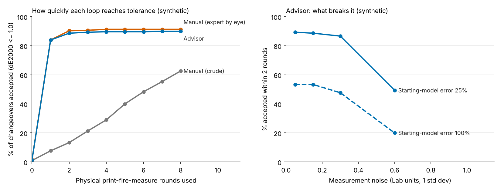

# Colour-correction advisor: synthetic demo

A small simulation that tests one idea for digitally printed ceramic tiles:

> If you **measure** how far a production tile is from its master (in Lab colour),
> and you have even a rough model of how each ink channel moves the fired colour,
> you can **calculate** the change to make to the print file instead of guessing.

Everything here is **synthetic**. The "printer + glaze + kiln" is an invented
stand-in function, not any real process, and no real customer data is used.
The numbers show how the method behaves under the stated assumptions. They do
not show that it will work on real tiles. A pilot on real tiles is what would
show that.



*Left: share of simulated changeovers that reach tolerance after each number of
physical rounds. Right: how the advisor degrades as measurement noise and
starting-model error grow. Full tables: [results/summary.md](results/summary.md).*

## What it simulates

* A product design with 4 colour zones, each printed from 6 ink channels.
* A production run whose process has drifted by an unknown amount (ink strength
  and a kiln shift).
* The only lever is a gain per ink channel in the print file (like "brown +4%").
* Each round = print variants, fire, measure with a spectrophotometer (noisy).
* Three strategies are compared:
  * **Manual (crude)**: changes one channel at a time, 6 variants per round.
  * **Manual (expert by eye)**: combined changes across channels, 6 variants per
    round, but never learns from the measurements.
  * **Advisor**: solves for the channel changes that cancel the measured Lab
    difference, prints 3 candidates, then updates its model from what was measured.
* "Accepted" means the average CIEDE2000 colour difference over the zones is
  at or below 1.0.

## Run it

```bash
python3 -m venv .venv
source .venv/bin/activate
pip install -r requirements.txt
python simulate.py              # about 2-3 minutes, 300 simulated changeovers
python simulate.py --events 50  # quick test, under 1 minute
```

Outputs go to `results/`:

* `summary.md`: the tables
* `sensitivity.csv`: the raw sensitivity grid
* `convergence.png`: the two charts

## What the results say (default settings, seed 7)

* At the headline settings (measurement noise 0.15 Lab units, starting-model
  error 25%), the advisor reaches tolerance in one round for 84% of changeovers
  and within two rounds for 89%. If the starting-model error is 50%, the
  two-round figure drops to about 77-84% for noise up to 0.3 Lab units.
* It prints 3 variants a round, against 6 for the manual loops.
* The **expert-by-eye** manual loop does about as well as the advisor on rounds
  in this simulation. So the advisor's advantage here is fewer variants and not
  depending on one person's judgement, not fewer rounds. Whether real QC
  practice looks more like the crude loop or the expert loop is unknown. It has
  to be measured from real lab logs.
* About 6% of simulated changeovers **cannot** be fixed by editing the file at
  all (a kiln-type shift moves the colour in a direction no ink channel can
  cancel). A real tool has to say so instead of iterating.
* The method breaks when measurement noise reaches about 0.6 Lab units, and
  degrades a lot when the starting model is poor (100% error). So measurement
  repeatability has to be checked before anything else.

## Limits

* The stand-in process is smooth and low-dimensional. Real ceramic inks,
  glazes and firing are messier.
* Gloss is not modelled.
* The manual strategies are guesses at human behaviour, not measurements.
* The three process-drift settings were raised once after the first run because
  the starting error was too small to look like a real shade problem. They were
  set from the starting error, not from the results.

## What you see when you run it

* The terminal prints the same tables that are written to `results/summary.md`.
* `results/convergence.png` and `results/sensitivity.csv` are rewritten.
* There is no dashboard or server. It is a command-line simulation, and the
  chart above is the visual output.
* The committed `results/` come from the full default run (300 changeovers).
  A quick `--events 50` run is noisier. For example the advisor is accepted in
  one round for about 80% of changeovers instead of 84%, and the share of
  changeovers no file change can fix is about 12% instead of 6%. Same method,
  smaller sample.

## Files in this repository

* `simulate.py`: the whole simulation, commented
* `requirements.txt`: Python packages
* `results/summary.md`, `results/sensitivity.csv`, `results/convergence.png`:
  output of the full run
* `.gitignore`: keeps the virtual environment and any PDFs out of the repository

Built with help from Claude (Anthropic), which wrote and edited the code.
